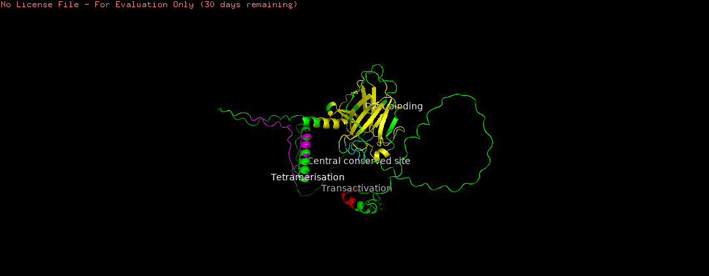

# TP53-comparative-analysis
# TP53 Comparative Analysis: Conservation, Phylogeny and Structure

Python pipeline that compares TP53 across five species to find conserved protein regions, tests whether they fall inside known functional domains, and maps them onto the AlphaFold structure of human TP53.

**Status: work in progress.** Figures and documentation are being improved.

## Research question
Which parts of TP53 are conserved across species, and do these conserved regions overlap its functional domains?

## Pipeline (run in this order)
1. `01_extract_proteins.py`: finds the longest ORF in each species' TP53 DNA sequence and translates it to protein
2. ClustalW (outside Python): multiple sequence alignment, saved as `TP53_MSA.fasta`
3. `02_msa_conservation.py`: finds conserved positions and regions and maps them to human TP53 residue numbers
4. `03_phylogenetic_tree.py`: neighbor-joining tree with 100 bootstrap replicates
5. InterProScan (outside Python): domain annotation of human TP53 (`tp53_human.tsv`)
6. `04_interproscan_domains.py`: converts the InterProScan output to a clean CSV
7. `05_structure_mapping.py`: conservation coverage per domain, overlap between conserved regions and domains, and conserved residues in the AlphaFold model (`TP53_structure_3D.pdb`)

## Species
(Human, Cow, Dog, Mouse and Zebrafish)

## Results
(see `TP53_final_summary.csv`)



## How to run
Put all files in one folder and run the scripts in the order above:
```bash
pip install -r requirements.txt
python 01_extract_proteins.py
```

## Limitations
- ORFs are searched on the forward strand only
- Protein identity uses a simple alignment without a substitution matrix
- Conservation is based on five species
- Structure mapping uses residue numbers; AlphaFold confidence (pLDDT) is not analyzed yet

## Author
Fatima Qasim (fatimabiotech)
